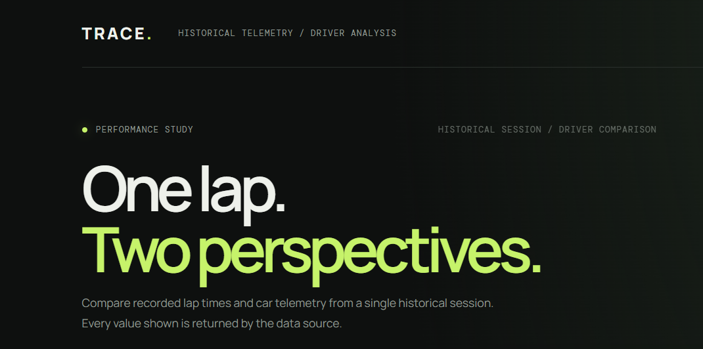
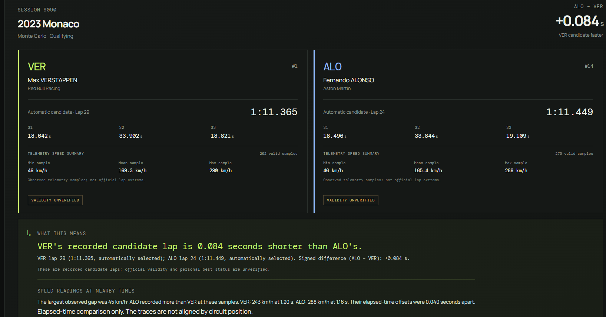
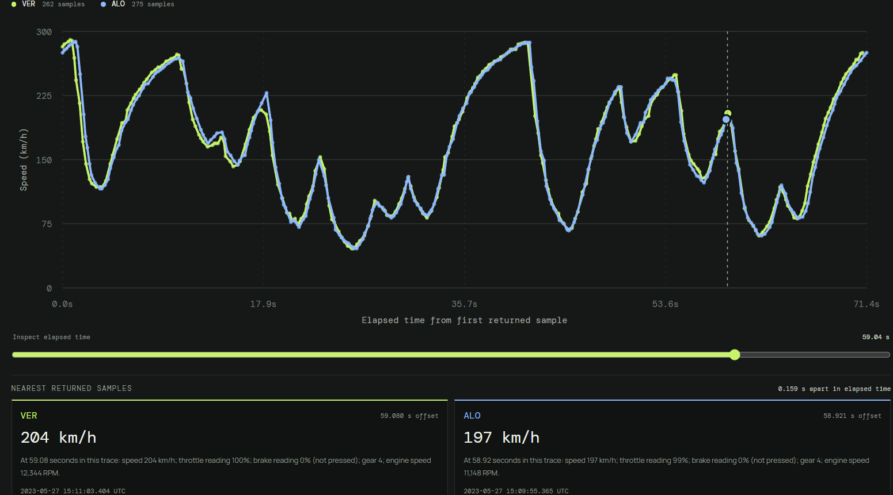
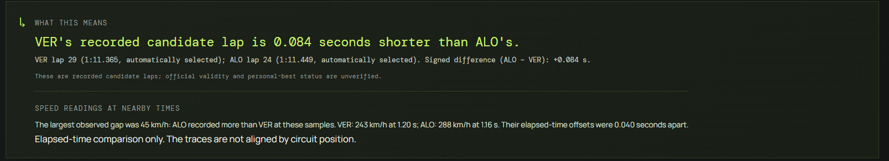
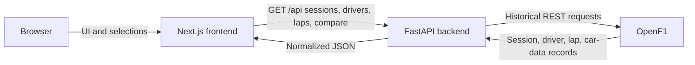

# TRACE — Telemetry & Race Analysis for Competitive Engineering

**Explore historical Formula 1 telemetry and compare drivers' recorded candidate laps.** TRACE is a locally run analysis platform that turns timing and car-data samples into an interactive, clearly qualified comparison.

## Screenshots

The images below show the locally running TRACE dashboard and its historical comparison workflow.



*Dashboard overview and session/driver selection.*



*Selected candidate lap times and sector summaries for both drivers.*



*Interactive speed traces with elapsed-time sample inspection.*



*Lap-time explanation and the bounded elapsed-time speed-gap insight.*

## Overview

Motorsport telemetry is detailed and easy to misread without context. TRACE brings historical session discovery, candidate-lap timing, and timestamped car data together in one interface, with plain-English explanations that separate recorded facts from conclusions the data cannot support.

TRACE is intended for F1 fans and developers exploring historical performance data. Its goal is to make comparisons approachable while making data limitations visible. It is an independent project and is not affiliated with Formula 1, the FIA, or any team.

## Features

- Discover provider-returned meetings and sessions by year, then list drivers participating in the selected session.
- Choose automatic candidate laps or manually select eligible lap numbers when the provider supplies the required timing metadata.
- Compare recorded lap and sector times, with a clearly defined signed delta.
- Explore interactive speed traces against elapsed time and inspect each driver's nearest available timestamped sample.
- Review sample-based minimum, maximum, and mean speed summaries, plus a bounded nearest-sample speed-gap insight.
- Read concise explanations based on the active API response, with explicit qualifications for missing or unverified data.

Candidate laps are not presented as officially valid laps or personal bests. TRACE currently has no circuit-distance alignment.

## Tech stack

- **Frontend:** Next.js 15 App Router, React 19, TypeScript, and the project's responsive CSS stylesheet.
- **Backend:** Python 3.10+, FastAPI, and Uvicorn.
- **Historical provider:** OpenF1 REST API. FastF1 remains a separate adapter and diagnostic tool; its archive access issue is unresolved.
- **Backend data libraries:** Pydantic (through FastAPI), pandas, NumPy, and HTTPX for provider requests.

The browser renders the dashboard and requests typed JSON from the FastAPI service. The backend discovers sessions, selects candidate laps, fetches car data from OpenF1, and returns normalized comparison results.

## Architecture



The diagram shows the current historical flow. FastF1 is not the provider used by the comparison API.

## Run locally

Prerequisites: Windows PowerShell, Python 3.10 or newer, and Node.js 20.9 or newer. Use two PowerShell terminals, both opened in the repository root (`D:\TRACE`). No API key is needed for the current historical OpenF1 workflow.

### Terminal 1 — backend

```powershell
cd D:\TRACE\backend
python -m venv .venv
.\.venv\Scripts\python.exe -m pip install -r requirements.txt
.\.venv\Scripts\python.exe -m uvicorn app.main:app --reload --host 127.0.0.1 --port 8000
```

### Terminal 2 — frontend

```powershell
cd D:\TRACE\frontend
npm ci
npm run dev
```

Open <http://localhost:3000>. The frontend uses `NEXT_PUBLIC_API_URL` for its backend origin; it defaults to `http://127.0.0.1:8000`. If you need another API origin, create `frontend/.env.local` with a local value such as:

```dotenv
NEXT_PUBLIC_API_URL=http://127.0.0.1:8000
```

No credentials or secrets belong in this variable. For the API, open <http://127.0.0.1:8000/api/health> and <http://127.0.0.1:8000/docs>. The health endpoint should return `{"status":"ok","service":"trace-api"}`. OpenF1 rate limits can temporarily prevent metadata or comparison requests; wait for the indicated cooldown rather than repeatedly retrying.

If port 3000 is already occupied, Next.js selects another port and prints the address to open. Keep that terminal running while using the dashboard.

## Data sources and methodology

The comparison workflow uses OpenF1's historical `/meetings`, `/sessions`, `/drivers`, `/laps`, and `/car_data` endpoints. The backend joins returned meetings and sessions by provider `meeting_key` and uses the stable `session_key` for selected-session requests. OpenF1 documents free historical access from 2023 onward; access and returned data are subject to provider availability and terms. FastF1 is retained for a separate historical adapter/diagnostic path, but it is not used by the current comparison endpoints; its previously observed Formula 1 archive HTTP 401 and mirror HTTP 404 remain unresolved. See the detailed [data-validation record](docs/data-validation.md).

TRACE's current candidate policy chooses the shortest provider-returned lap with a finite lap duration, three finite sector durations, and an explicit `is_pit_out_lap=false`. Manual options use those same checks, require an unambiguous lap number and a usable timezone-aware start timestamp, and retrieve telemetry for the exact requested lap. These are TRACE's eligibility rules, not proof of official lap validity, a clean lap, or personal-best status. OpenF1 does not provide sufficient validity evidence for TRACE to establish those claims.

The signed timing delta is **driver B's lap time minus driver A's lap time**. A negative value means B's recorded candidate lap is shorter; a positive value means A's is shorter; zero means equal recorded times.

Car-data samples retain their timestamps. Each trace's chart coordinate is elapsed seconds from that trace's first returned telemetry sample; the traces are not circuit-position aligned, and equal elapsed offsets do not establish equal track positions. TRACE does not match rows by index or interpolate the plotted traces. The speed-gap insight checks nearest speed-valid samples within the shared elapsed-time interval and a maximum separation of 0.150 seconds; it is a TRACE heuristic, not a same-position measurement or causal explanation. Speed summaries use finite speed values actually present in each returned telemetry trace and report the number of samples used.

The 2024 British GP qualifying comparison and other session/driver/lap paths have previously been retrieved through the real OpenF1 adapter; see the validation record for exact evidence and dates. Automated tests use mocked provider responses and do not prove current upstream availability. Distance coordinates are not calibrated or used by the dashboard, source freshness is not provided by OpenF1, and provider redistribution terms have not been assessed for public deployment.

The standalone live probe is opt-in. From `D:\TRACE\backend`, run `\.venv\Scripts\python.exe -m scripts.validate_openf1` to resolve and inspect the target through returned metadata, or use `\.venv\Scripts\python.exe -m scripts.validate_openf1 --telemetry-only` to request only the previously identified telemetry windows. The latter reuses known session/lap metadata and is not a fresh metadata validation. Both commands contact OpenF1 and respect the adapter's pacing/retry bounds; do not run them as part of routine tests.

## Testing

Run these from the indicated directories:

```powershell
cd D:\TRACE\backend
.\.venv\Scripts\python.exe -m pytest -q

cd D:\TRACE\frontend
npm run lint
npm run typecheck
npm run build
```

The backend suite covers normalization, candidate selection, comparison behavior, error handling, and the health endpoint with offline fixtures/mocks. Frontend lint and typecheck validate source quality and types; the production build checks Next.js compilation. The live OpenF1 validation commands are intentionally opt-in and documented in `docs/data-validation.md`, not part of pytest.

For an isolated live OpenF1 probe, use the validation script described in the data-validation document. It makes external requests and must not be treated as an ordinary test.

## Roadmap

Possible future work, not currently implemented:

- Validate a trustworthy circuit-distance coordinate before offering distance-aligned comparisons.
- Explore cumulative time-delta views with clearly documented alignment assumptions.
- Add further evidence-backed historical telemetry analysis.
- Assess provider terms and deployment requirements before considering a public deployment.

## Project status and acknowledgements

TRACE currently runs locally and is **not publicly deployed**. It uses the [OpenF1 API](https://openf1.org/docs/) and retains [FastF1](https://docs.fastf1.dev/) for a separate adapter/diagnostic path. The app is built with [Next.js](https://nextjs.org/docs), [React](https://react.dev/), [TypeScript](https://www.typescriptlang.org/docs/), [FastAPI](https://fastapi.tiangolo.com/), and [Uvicorn](https://www.uvicorn.org/). Provider names and marks belong to their respective owners; TRACE is an independent, non-affiliated project.
