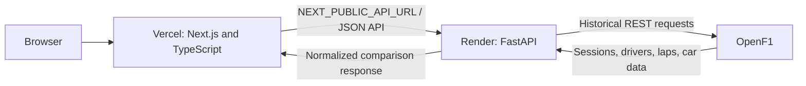

# TRACE — Telemetry & Race Analysis for Competitive Engineering

Explore recorded Formula 1 sessions through driver comparisons, candidate-lap timing, and interactive telemetry. TRACE presents the data with plain-language context and clear limits on what it can establish.

**[Open the live TRACE demo](https://trace-seven-rho.vercel.app/)** · [View the source on GitHub](https://github.com/thearnavjain/TRACE) · [API health](https://trace-0krh.onrender.com/api/health)

[](https://nextjs.org/docs) [](https://react.dev/) [](https://www.typescriptlang.org/docs/) [](https://fastapi.tiangolo.com/)

## Screenshots

The following genuine captures show TRACE’s session workflow and comparison analysis.


*Dashboard header and comparison introduction.*


*Recorded lap and sector times, telemetry summaries, and the lap-time explanation.*


*Speed traces with the slider and nearest timestamped samples for each driver.*


*Plain-language lap-time and elapsed-time speed-gap insights.*

## What is TRACE?

TRACE means **Telemetry & Race Analysis for Competitive Engineering**. It is a historical Formula 1 telemetry analysis and driver-comparison application that makes recorded session data easier to explore. TRACE combines lap timing, telemetry visualisation, and concise explanations to help F1 fans and developers understand the returned data without overstating what it proves.

## Features

- Discover historical events and sessions by year using provider-returned metadata, then choose participating drivers.
- Compare automatic candidate laps or select eligible lap numbers manually.
- View recorded lap times, sector times when available, and the signed lap-time difference.
- Explore each driver's speed trace against elapsed time and inspect nearby timestamped telemetry samples.
- Inspect available speed, throttle, brake, gear, and RPM values, with missing readings shown as unavailable.
- Read plain-language explanations of the lap-time difference and the largest observed nearby speed difference.
- See loading, empty, unavailable-data, provider-error, and rate-limit states where applicable.

TRACE's candidate-lap rules do not verify official lap validity or personal-best status. The telemetry chart uses elapsed time, not circuit distance; similar elapsed times do not mean the cars were at the same track position.

## Live deployment and architecture

The public application uses separate frontend and backend services. The browser loads the Next.js application from Vercel, which calls the FastAPI service on Render using `NEXT_PUBLIC_API_URL`. FastAPI makes paced historical requests to OpenF1 and returns normalized data. Render's `FRONTEND_ORIGIN` setting allows the deployed frontend origin through CORS.



- **Live frontend:** [trace-seven-rho.vercel.app](https://trace-seven-rho.vercel.app/)
- **Backend API:** [trace-0krh.onrender.com](https://trace-0krh.onrender.com)
- **API health check:** [GET /api/health](https://trace-0krh.onrender.com/api/health)
- **API reference:** [FastAPI interactive docs](https://trace-0krh.onrender.com/docs)

The health endpoint checks that the API process responds; it does not contact OpenF1 or guarantee that every provider request will succeed. The Render backend currently uses the Free plan and may spin down after inactivity, so its first request after a quiet period can take time to wake.

## Tech stack

- **Frontend:** Next.js 15 App Router, React 19, TypeScript, and responsive CSS.
- **Backend:** Python, FastAPI, Pydantic response models, and Uvicorn.
- **Provider requests:** HTTPX client for OpenF1's historical REST API.
- **Data processing:** pandas and NumPy are dependencies used by the retained FastF1 adapter and related data tooling.
- **Additional adapter:** FastF1 remains available for separate historical diagnostics; it is not the source used by the current comparison endpoints, and its upstream archive-access issue remains unresolved.

The dependency declarations are in [`frontend/package.json`](frontend/package.json) and [`backend/requirements.txt`](backend/requirements.txt).

### Repository layout

```text
TRACE/
├── backend/       FastAPI app, provider adapters, scripts, and tests
├── frontend/      Next.js App Router application and static assets
├── docs/          Data-validation record and genuine screenshots
├── data/cache/    Ignored local FastF1 cache
├── .env.example   Local configuration variable names and examples
└── README.md
```

## Run locally

Prerequisites: Python 3.10 or newer and Node.js 20.9 or newer. Start the backend and frontend in separate terminals. These instructions use the repository root as the starting directory.

### Windows PowerShell

**Terminal 1 — backend**

```powershell
cd D:\TRACE\backend
python -m venv .venv
.\.venv\Scripts\Activate.ps1
python -m pip install -r requirements.txt
$env:FRONTEND_ORIGIN = "http://localhost:3000"
python -m uvicorn app.main:app --reload --host 127.0.0.1 --port 8000
```

**Terminal 2 — frontend**

```powershell
cd D:\TRACE\frontend
npm ci
$env:NEXT_PUBLIC_API_URL = "http://127.0.0.1:8000"
npm run dev
```

Open [http://localhost:3000](http://localhost:3000). The backend health endpoint is [http://127.0.0.1:8000/api/health](http://127.0.0.1:8000/api/health), and local API documentation is at [http://127.0.0.1:8000/docs](http://127.0.0.1:8000/docs).

### macOS and Linux

Open two terminals from the repository checkout.

**Terminal 1 — backend**

```bash
cd /path/to/TRACE/backend
python3 -m venv .venv
source .venv/bin/activate
python -m pip install -r requirements.txt
export FRONTEND_ORIGIN="http://localhost:3000"
python -m uvicorn app.main:app --reload --host 127.0.0.1 --port 8000
```

**Terminal 2 — frontend**

```bash
cd /path/to/TRACE/frontend
npm ci
export NEXT_PUBLIC_API_URL="http://127.0.0.1:8000"
npm run dev
```

Then open [http://localhost:3000](http://localhost:3000). The local values above are development settings; use the deployed origins only in the corresponding hosting settings.

## Configuration

| Variable | Used by | Purpose | Example |
| --- | --- | --- | --- |
| `NEXT_PUBLIC_API_URL` | Next.js frontend | Base URL used by browser requests to the FastAPI service. This value is public and is not a secret. | Local: `http://127.0.0.1:8000` · Production: `https://trace-0krh.onrender.com` |
| `FRONTEND_ORIGIN` | FastAPI backend | One frontend origin permitted by CORS. Supply scheme and hostname only; do not include a path or trailing slash. | Local: `http://localhost:3000` · Production: `https://trace-seven-rho.vercel.app` |

The backend allows `http://localhost:3000` and `http://127.0.0.1:3000` for local development without requiring `FRONTEND_ORIGIN`. A deployed origin must use HTTPS. Keep environment-specific values in the hosting dashboard or an ignored local environment file; do not commit `.env` files or credentials.

## Testing and validation

Run the backend tests from `backend` and frontend checks from `frontend`:

```powershell
# Backend
cd D:\TRACE\backend
.\.venv\Scripts\python.exe -m pytest -q

# Frontend
cd D:\TRACE\frontend
npm run lint
npm run typecheck
npm run build
```

Backend tests use mocked provider responses and offline fixtures; they do not establish current OpenF1 availability. The frontend has lint, typecheck, and production-build scripts, but no configured automated browser-interaction test suite. A live OpenF1 probe is separate and opt-in; see [`docs/data-validation.md`](docs/data-validation.md) for its command and recorded findings.

## Data methodology and limitations

The comparison workflow uses OpenF1's historical `/meetings`, `/sessions`, `/drivers`, `/laps`, and `/car_data` endpoints. It resolves event and session options from returned provider metadata and uses stable session keys for later requests. The app handles provider errors and rate limits; historical access, response completeness, and availability remain subject to OpenF1's service and terms.

TRACE's automatic candidate policy selects the shortest returned lap that has a finite lap time, finite times for all three sectors, and an explicit `is_pit_out_lap=false`. Manual options follow those eligibility checks and additionally require an unambiguous lap number and a timezone-aware start timestamp so the requested lap can be retrieved. These are application selection rules, not official validity checks. OpenF1 does not provide sufficient evidence for TRACE to label a candidate officially valid, clean, or a personal best.

The signed lap-time delta is **Driver B minus Driver A**. A negative value means Driver B's selected recorded lap is shorter; a positive value means Driver A's is shorter; zero means their recorded times are equal.

Telemetry samples retain provider timestamps. Each trace's elapsed-time origin is its own first returned sample. TRACE plots speed over elapsed time and compares nearest speed-valid samples only within the shared elapsed-time range and within a 0.150-second separation threshold. It does not interpolate or align readings by sample row. Because circuit distance is not calibrated, the chart and speed-gap insight do not represent matching track positions and cannot identify a specific corner or explain why a time or speed difference occurred.

OpenF1 does not provide source-freshness information in the comparison response. The UI reports retrieval time, but that is not the provider's measurement timestamp. Detailed live and offline evidence, including the known 2024 British GP qualifying example, is preserved in the [data-validation record](docs/data-validation.md).

## Deployment guide

The existing deployment is already configured; these notes describe its current arrangement.

### Vercel frontend

- Repository: [`thearnavjain/TRACE`](https://github.com/thearnavjain/TRACE)
- Project root: `frontend`
- Framework: Next.js; the project uses its normal Next.js build configuration.
- Production environment variable: `NEXT_PUBLIC_API_URL=https://trace-0krh.onrender.com` (also configured for Preview).

### Render backend

- Repository: [`thearnavjain/TRACE`](https://github.com/thearnavjain/TRACE)
- Service root: `backend`
- Build command: `pip install -r requirements.txt`
- Start command: `uvicorn app.main:app --host 0.0.0.0 --port $PORT`
- Health check path: `/api/health`
- Environment variable: `FRONTEND_ORIGIN=https://trace-seven-rho.vercel.app`

No API key is configured or required by the current OpenF1 adapter. Do not add credentials to the repository. The free Render instance may sleep while idle; API health and provider-data availability are separate checks.

## Project status and possible next steps

TRACE is publicly accessible at the live demo link above. Its current workflow supports historical session discovery and candidate-lap comparisons with timestamped telemetry. Official lap validity and circuit-distance alignment remain unresolved limitations.

Possible future work, not implemented in the current app:

- Establish and validate a circuit-distance coordinate before offering distance-aligned traces.
- Explore cumulative time-delta analysis with explicit alignment assumptions.
- Expand historical insights only where the source data supports them.

## Acknowledgements

TRACE uses [OpenF1](https://openf1.org/docs/) for historical Formula 1 data and builds on [Next.js](https://nextjs.org/docs), [React](https://react.dev/), [TypeScript](https://www.typescriptlang.org/docs/), [FastAPI](https://fastapi.tiangolo.com/), [Uvicorn](https://www.uvicorn.org/), [HTTPX](https://www.python-httpx.org/), and [FastF1](https://docs.fastf1.dev/). TRACE is an independent project and is not affiliated with Formula 1, the FIA, or any team.
